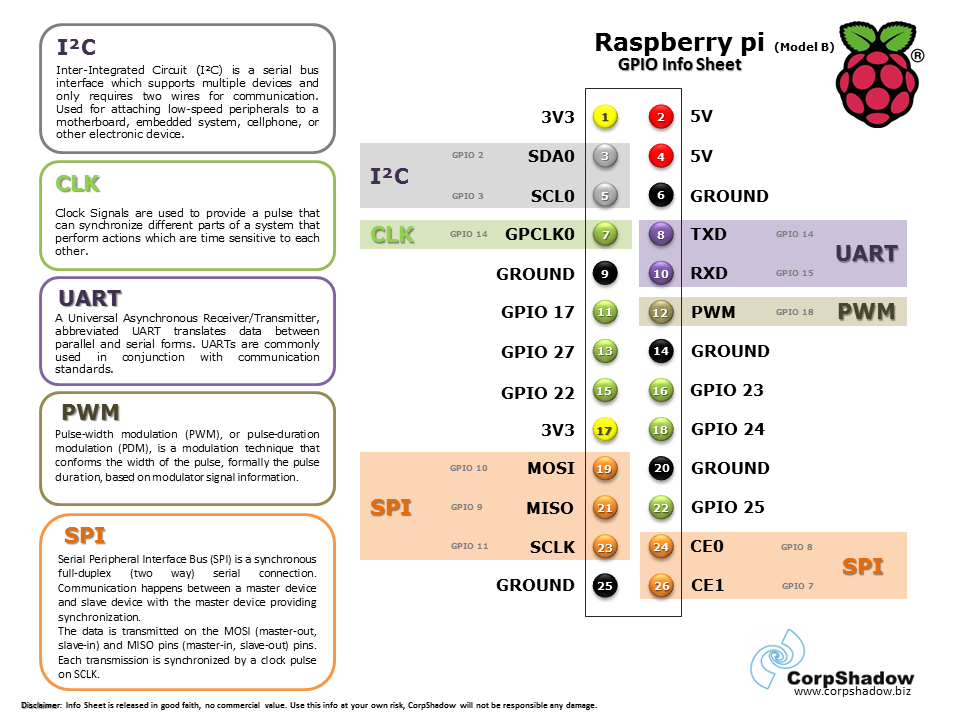
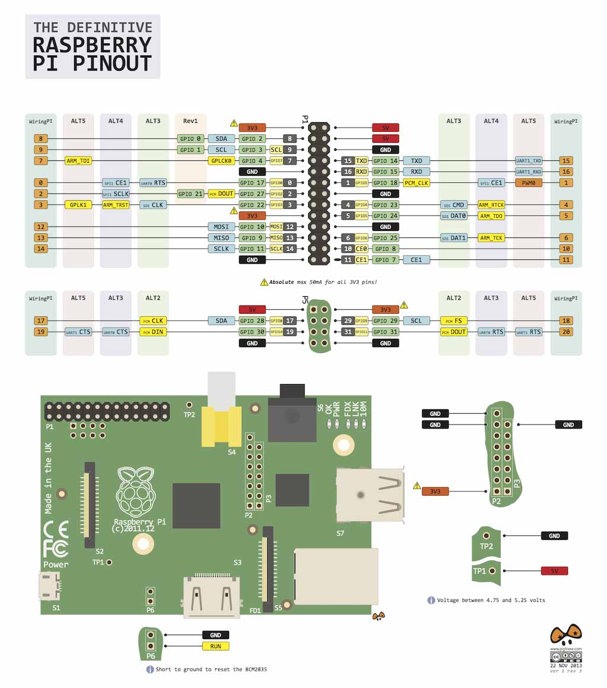
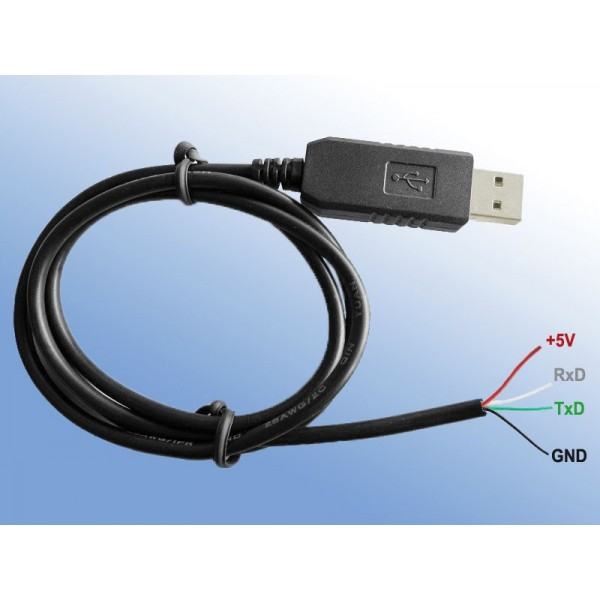

# PI Pinout & GPIO

## Pinout Diagrams





## GPIO Commands

Install `gpio` from http://wiringpi.com/the-gpio-utility/

```bash
root@raspberrypi:~# gpio -g mode 17 out
root@raspberrypi:~# gpio -g write 17 1
```

## Relay Wiring (Smartpow)

| Pi - GPIO | Relay pin |
| --- | --- |
| 17 | inp1 |
| 27 | inp2 |
| 22 | inp3 |
| 23 | inp4 |
| 4 (5v) | Relay VCC |
| 20 (GND) | GND |

***Put a jumper on the relay board (JVCC & VCC).***

## LCD 1602 Wiring

**PI - Pin 2 (5v) ------ VCC LCD**

## Reference

* Best doc for relay: http://www.instructables.com/id/Web-Controlled-8-Channel-Powerstrip/?ALLSTEPS
