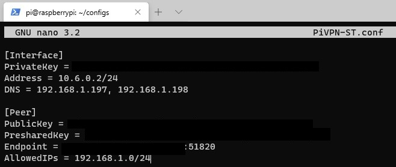

# WireGuard Client Setup

Client-side config to pair with a server from [Server Setup](server_setup.md), plus generic and Raspberry Pi–specific notes.

## CentOS 7 server → client

```bash
#nano client01.conf
```

```conf
[Interface]
Address = 192.168.200.5/24
PrivateKey = $_PRIVATE_KEY
DNS = 8.8.8.8

[Peer]
PublicKey = $_SERVER_PUBLIC_KEY
AllowedIPs = 0.0.0.0/0, ::/0
Endpoint = SERVERIP:55525
PersistentKeepalive = 15
```

```bash
#cat client-private.key
#cat server-public.key
```

Copy each key in, put your server's real IP address and port into `Endpoint = IPAddress:PORT`, and save.

## Alpine/VirtualBox server → client

```conf
[Interface]
Address = 10.0.0.2/32
PrivateKey = $Client_PRIVATE_KEY
DNS = 8.8.8.8

[Peer]
PublicKey =  $_SERVER_PUBLIC_KEY
AllowedIPs = 0.0.0.0/0, ::/0
#Endpoint = 10.0.2.15:55525
Endpoint =192.168.1.37:55525
PersistentKeepalive = 15
```

## Generic Linux client (e.g. connecting to a Linode/VPS server)

- [ref1](https://www.wundertech.net/setup-wireguard-on-a-raspberry-pi-vpn-setup-tutorial/)

```bash
nano /etc/wireguard/wg0.conf
```

```conf
# Config client for Linode VPN #
[Interface]
## This Desktop/client's private key ##
PrivateKey = {KEY_GOES_HERE}

## Client ip address ##
Address = 10.8.0.2/24

[Peer]
## Remote Ubuntu 20.04 wg0 server public key ##
PublicKey = {KEY_GOES_HERE}

## set ACL ##
#################################################
## Allow remote server as gateway
## Edit/Update old AllowedIPs entry as follows
## Otherwise client won't show server's IP
#################################################
AllowedIPs = 0.0.0.0/0

## Your Ubuntu 20.04 LTS server's public IPv4/IPv6 address and port ##
Endpoint = {SERVER_IP_HERE}:51194

##  Keep connection alive ##
PersistentKeepalive = 15
```

```bash
$ wg-quick up wg0
```

## Raspberry Pi: restricting AllowedIPs to LAN-only

By default, `AllowedIPs = 0.0.0.0/0` routes **all** client traffic through your home network (full-tunnel VPN). To send only local traffic through WireGuard instead, change it to your LAN's IP range.

For most people that's `192.168.1.0/24` or `192.168.0.0/24` — check your router's LAN setup page if unsure. If you also want VPN clients to talk to each other, add the VPN subnet too (e.g. `10.6.0.0/24`).


